# Getting Started with CWH Control Panel — Free Edition

A complete, beginner-friendly guide that takes you from a **blank Rocky Linux 9
server** to a **working hosting panel** with websites, mail, DNS, databases and
SSL — and then shows you how to use it day to day.

> **Who this is for:** someone who has never installed a hosting panel before.
> Every command is copy-pasteable, every screen is shown, and nothing is assumed
> beyond basic SSH knowledge.

---

## Table of contents

1. [What is CWH Control Panel?](#1-what-is-cwh-control-panel)
2. [About this edition](#2-about-this-edition)
3. [Prerequisites](#3-prerequisites)
4. [Prepare the server](#4-prepare-the-server)
5. [Install the panel step by step](#5-install-the-panel-step-by-step)
6. [First login](#6-first-login)
7. [Admin panel tour](#7-admin-panel-tour)
8. [Your first hosting setup (walkthrough)](#8-your-first-hosting-setup-walkthrough)
9. [Customer panel tour](#9-customer-panel-tour)
10. [Common tasks (recipes)](#10-common-tasks-recipes)
11. [Day-2 operations](#11-day-2-operations)
12. [Troubleshooting](#12-troubleshooting)
13. [Uninstall](#13-uninstall)
14. [FAQ](#14-faq)
15. [Security checklist](#15-security-checklist)
16. [License and support](#16-license-and-support)

---

## 1. What is CWH Control Panel?

CWH Control Panel is a **Linux web hosting control panel** for Rocky Linux 9,
built from scratch (no framework, no CloudLinux). It gives you two separate
interfaces on one server:

| Interface | Looks like | Who uses it | Address |
|---|---|---|---|
| **Admin panel** | WHM (server owner) | You, the hosting provider | `https://<server>:8443/login` |
| **Customer panel** | cPanel (website owner) | Your customers | `https://<server>/panel/login` |

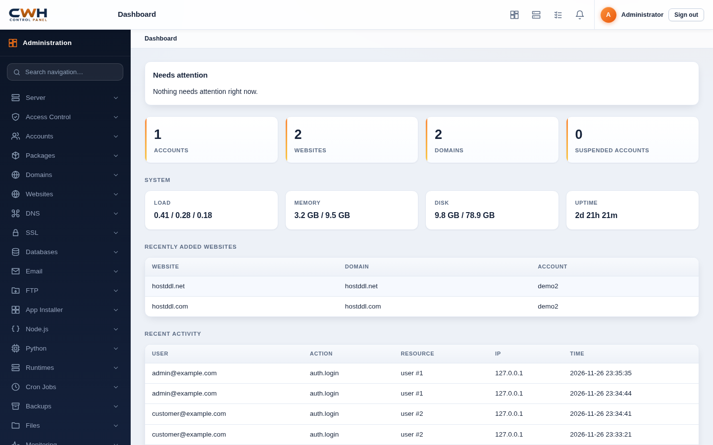

The panel manages the real hosting stack underneath:

- **Nginx** web server with per-account isolated workers (optional)
- **PHP-FPM** with several PHP versions (7.4 → 8.5, via Remi)
- **MariaDB** databases, **PowerDNS** DNS, **Postfix + Dovecot** mail
- **vsftpd** FTP, **ClamAV** antivirus, **fail2ban** brute-force protection
- **SELinux** in enforcing mode, systemd cgroups for CPU/RAM/IO/process limits

Everything is provisioned through a small **privileged agent** (a Rust daemon
behind a protected Unix socket), so the web panel never runs as root.

---

## 2. About this edition

CWH Control Panel (Free Edition) includes the complete hosting feature set:

- websites, add-on domains, parked domains and subdomains
- DNS zones, records, templates and DNSSEC
- email: mailboxes, forwarders, catch-all, mailing lists, Sieve filters and
  Roundcube webmail with single sign-on
- MariaDB databases with phpMyAdmin
- FTP accounts and jailed SSH access
- SSL certificates (Let's Encrypt, automatic renewal), force HTTPS and HSTS
- on-demand, scheduled and S3-compatible remote backups
- cron jobs with captured output
- the App Installer (90+ applications)
- multi-PHP (7.4–8.5), per-account isolation, ModSecurity WAF, firewall,
  ClamAV antivirus and fail2ban
- resource limits: disk/inodes, bandwidth, CPU, RAM, IOPS and process caps

Everything described in this guide is available in this edition and covered by
its test suite.

## 3. Prerequisites

### 3.1 Server

| Resource | Minimum | Recommended |
|---|---|---|
| CPU | 1 vCPU | 2+ vCPU |
| RAM | 2 GB | 4 GB (8 GB with many accounts) |
| Disk | 20 GB SSD | 40 GB+ SSD/NVMe |
| Architecture | x86_64 | x86_64 |

> **Why the RAM?** Each PHP-FPM worker, MariaDB, PowerDNS, Postfix, Dovecot and
> ClamAV all run on the same box. 2 GB works for a handful of small sites; 4 GB
> is comfortable.

### 3.2 Operating system

- **Rocky Linux 9.x** (fresh, minimal install). AlmaLinux 9 / RHEL 9 usually
  work, but Rocky 9 is the tested platform.
- **Root access** over SSH (or console).
- **SELinux must stay enforcing** (the panel ships its own policy module).
- The host should be **fresh**: a server that already runs another panel,
  Apache, or a hand-made Nginx/Postfix setup is not a good starting point.

Check your OS:

```bash
cat /etc/rocky-release
getenforce          # must print: Enforcing
```

### 3.3 Network and DNS

| Requirement | Details |
|---|---|
| Public **IPv4** | Required (IPv6 optional but recommended) |
| **Domain name** | Optional but strongly recommended — needed for trusted HTTPS on the panel itself |
| DNS control | You need to be able to create A/AAAA records at your registrar |

**Before installing, decide the panel hostname**, e.g. `panel.example.com`, and
create:

```
panel.example.com.   A      <your server IPv4>
panel.example.com.   AAAA   <your server IPv6>   (optional)
```

The installer tries to issue a **Let's Encrypt** certificate for this hostname.
If DNS is not live yet, the panel still installs and you can log in over plain
HTTP on port 8443 (see [5.5](#55-post-install-verification)); run the TLS
provisioner later.

> If you want the panel to also host **DNS zones** for your customers, create a
> second hostname pair later (`ns1.example.com`, `ns2.example.com`) pointing at
> the same server, and set them in **Admin → DNS → Nameservers**. Without a
> nameserver pair the panel does not create DNS zones.

### 3.4 Ports

Open these on your provider firewall / security group **and** in the OS
firewall (the installer opens them in `firewalld` automatically):

| Port | Protocol | Purpose |
|---|---|---|
| 22 | TCP | SSH (administration) |
| 80 | TCP | HTTP (websites + ACME challenges) |
| 443 | TCP | HTTPS (websites + customer panel) |
| **8443** | TCP | **Admin panel** (HTTPS) |
| 25 | TCP | Inbound SMTP (if you host mail) |
| 587 | TCP | Mail submission |
| 465 | TCP | SMTPS |
| 110 / 995 | TCP | POP3 / POP3S |
| 143 / 993 | TCP | IMAP / IMAPS |
| 21 + 30000-30100 | TCP | FTP + passive range |
| 53 | TCP/UDP | DNS (only if the panel is authoritative) |

> **Provider warning:** many VPS providers block **inbound port 25** by default.
> Outbound mail works, but you will not receive external mail until the provider
> unblocks it. Ask them to open 25/587/465 if you plan to host mailboxes.

### 3.5 Checklist before you start

- [ ] Fresh Rocky Linux 9 server, root SSH access
- [ ] Public IPv4 address
- [ ] A hostname (e.g. `panel.example.com`) with an A record — recommended
- [ ] Ports 80/443/8443 reachable from the internet
- [ ] A decision: will this server host **DNS** and **mail** too?
- [ ] ~30 minutes of time (the installer downloads a few hundred MB)

---

## 4. Prepare the server

Log in as root:

```bash
ssh root@<your-server-ip>
```

### 4.1 Set the hostname (recommended)

A correct hostname makes mail and TLS work smoothly. Replace
`panel.example.com` with your real name:

```bash
hostnamectl set-hostname panel.example.com
```

Make sure it resolves to the server:

```bash
getent hosts panel.example.com
# 203.0.113.10   panel.example.com
```

### 4.2 Update the base system (recommended)

```bash
dnf -y update
```

Reboot if the kernel was updated:

```bash
reboot
```

Reconnect with SSH afterwards.

### 4.3 Optional: timezone

```bash
timedatectl set-timezone UTC
```

---

## 5. Install the panel step by step

### 5.1 Get the code

**Option A — Git (recommended):** clone this repository (the Free Edition
source) into `/root/cwhpanel`:

```bash
cd /root
git clone https://github.com/cheap-web-hosting/cwhpanel.git cwhpanel
cd cwhpanel
```

**Option B — release archive:** download the archive, extract it to
`/root/cwhpanel`, and `cd` into it.

### 5.2 Run the installer

There are two modes:

**Interactive (asks for the panel host):**

```bash
./scripts/turn-up.sh
```

**Non-interactive (fully automatic; uses the server hostname or IP):**

```bash
./scripts/turn-up.sh --non-interactive
```

**Choose the panel hostname explicitly (best):**

```bash
./scripts/turn-up.sh --panel-domain=panel.example.com
```

The script must run **as root**. Expect **15–30 minutes**: it downloads and
installs Nginx, PHP (multiple versions), MariaDB, PowerDNS, Postfix, Dovecot,
ClamAV, vsftpd, builds the Rust agent, and initialises the database.

> You can safely re-run the installer later — every step is idempotent and it
> will not overwrite your settings or data.

### 5.3 What the installer does

| Step | What happens |
|---|---|
| 1/7 | Installs the OS packages (Nginx, MariaDB 10.11, Remi PHP 8.4 + 7.4–8.5, PowerDNS, Postfix/Dovecot, ClamAV, vsftpd, fail2ban) |
| 2/7 | Creates the MariaDB databases/users (panel + PowerDNS) |
| 3/7 | Configures PowerDNS (authoritative, local) |
| 4/7 | Configures mail (DKIM signing, TLS, virtual users) |
| 5/7 | Builds and loads the **SELinux** policy for the panel and accounts |
| 6/7 | Builds/installs the privileged agent, worker and mail-policy services |
| 7/7 | Creates the panel database, runs migrations, seeds the admin account, installs phpMyAdmin + Roundcube, provisions the panel TLS certificate |

Along the way it also:

- creates the dedicated **panel user** (the web app never runs as root or as
  Nginx),
- installs the **admin panel** on `https://<host>:8443`,
- opens the firewall ports,
- writes all secrets to `/opt/cwhpanel/.env`.

### 5.4 Read the summary and credentials

At the end you will see a summary like:

```
Done. cwhpanel is turned up.

  Panel    : https://panel.example.com/ (nginx + php-fpm pool 'panel')
  Admin    : https://panel.example.com:8443 (TLS; customer login on the public port)
  Database : cwhpanel (user cwhpanel)
  PowerDNS : pdns (gmysql, 127.0.0.1)
```

Your login credentials are in the panel's `.env`:

```bash
grep -E '^(ADMIN|CUSTOMER)_(EMAIL|PASSWORD)=' /opt/cwhpanel/.env
```

The install is **production-clean**: only the **admin** account exists. Demo
content (customer, package, demo hosting account) is opt-in — see
[5.6](#56-optional-demo-data).

### 5.5 Post-install verification

Run these checks:

```bash
# All services should say "active"
systemctl is-active cwhpanel-agent cwhpanel-worker cwhpanel-mail-policy \
  nginx php-fpm mariadb pdns postfix dovecot vsftpd clamd@scan

# The panel should answer
curl -s -o /dev/null -w '%{http_code}\n' https://panel.example.com/panel/login
```

Expected: a list of `active` and `200`.

Check the certificate:

```bash
openssl x509 -in /etc/cwhpanel/ssl/hostname/fullchain.pem -noout -issuer -dates
```

**If TLS was not provisioned** (the log says "hostname TLS not provisioned"),
you can still log in over **plain HTTP on port 8443**:

```
http://<server-ip>:8443/login
```

Fix the DNS record so the hostname points to the server, then re-run:

```bash
php /opt/cwhpanel/scripts/provision-hostname-tls.php
```

That command issues the certificate, adds HTTPS to the panel and mail services,
switches the admin port to TLS, and updates `APP_URL`.

> Let's Encrypt has a rate limit of 5 certificates per hostname per week. If you
> reinstall repeatedly, reuse an existing certificate or wait — the panel
> reports the exact retry time in the log.

### 5.6 Optional: demo data

To explore the panel with a pre-made customer, package and demo account:

```bash
cd /opt/cwhpanel
SEED_DEMO=1 php scripts/seed.php
```

This creates:

- customer login `customer@example.com` (password written to `.env`)
- a **Starter** package
- a **demo2** hosting account with two demo domains

> Do this on a **test** server, or delete the demo account afterwards. A
> production install should stay clean.

---

## 6. First login

### 6.1 Admin panel

Open:

```
https://<your-server>:8443/login
```

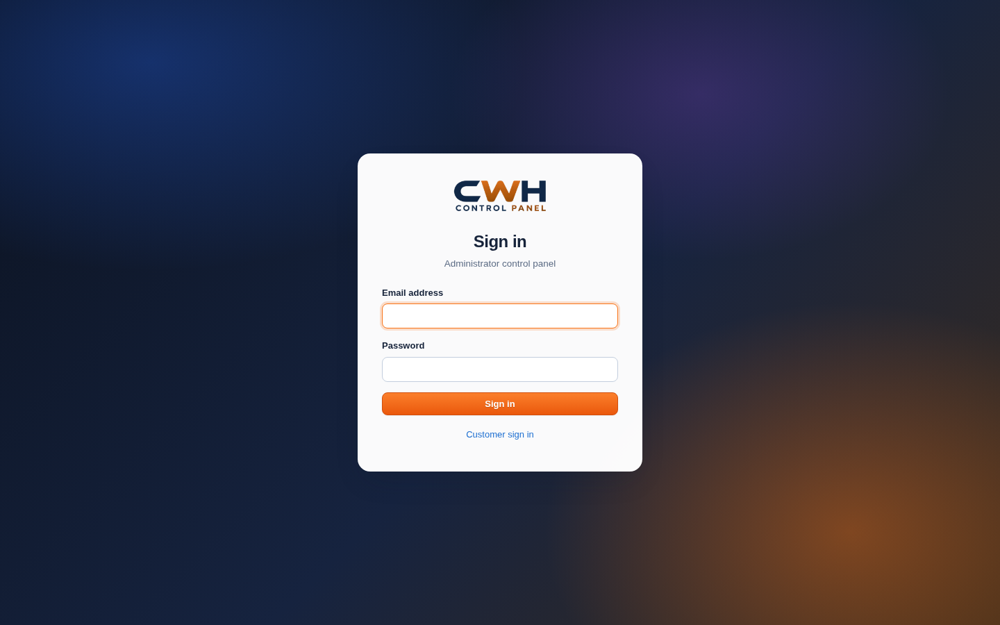

Sign in with `ADMIN_EMAIL` / `ADMIN_PASSWORD` from `/opt/cwhpanel/.env`.

After the first login, do these two things immediately:

**1. Change the admin password** (top-right menu → Account, or the
`Change password` card).

**2. Enable two-factor authentication.** The panel can enforce TOTP for every
admin:

```bash
# Enrol the admin and print a provisioning URI for your authenticator app
php /opt/cwhpanel/scripts/enroll-admin-2fa.php admin@example.com

# Enforce 2FA for all admins (recommended after enrolling)
php /opt/cwhpanel/scripts/enforce-admin-2fa.php
```

The provisioning URI can be opened with any TOTP app (Google Authenticator,
Aegis, 1Password…). Keep the recovery code in a safe place.

### 6.2 Customer panel

Open:

```
https://<your-server>/panel/login
```

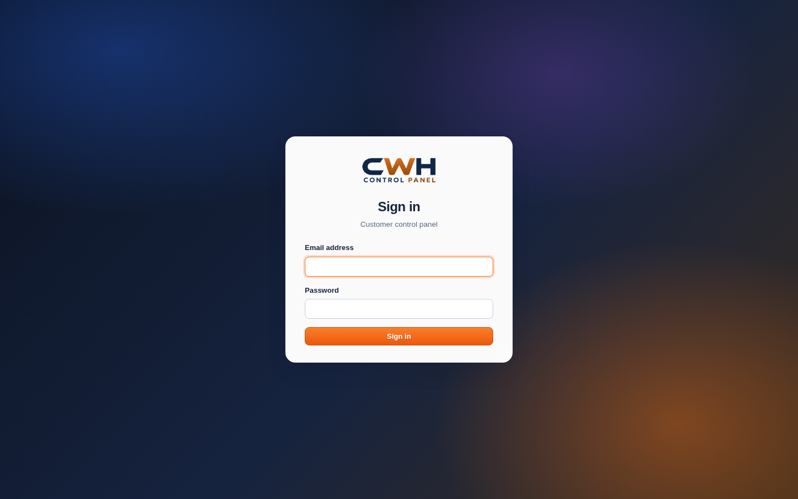

Customers sign in with their contact e-mail and the password you set when
creating their account.

---

## 7. Admin panel tour

The admin panel is organised like WHM: a dark sidebar with collapsible groups,
a search box, and a notification bell.

### 7.1 Dashboard


Shows:

- **Needs attention** — anything broken (services, quotas, failed jobs)
- **Accounts / Websites / Domains / Suspended** counters
- **System** — load, memory, disk, uptime
- **Recently added websites**
- **Recent activity** (audit log)

### 7.2 Packages

A **package** is a hosting plan: limits, features and defaults.

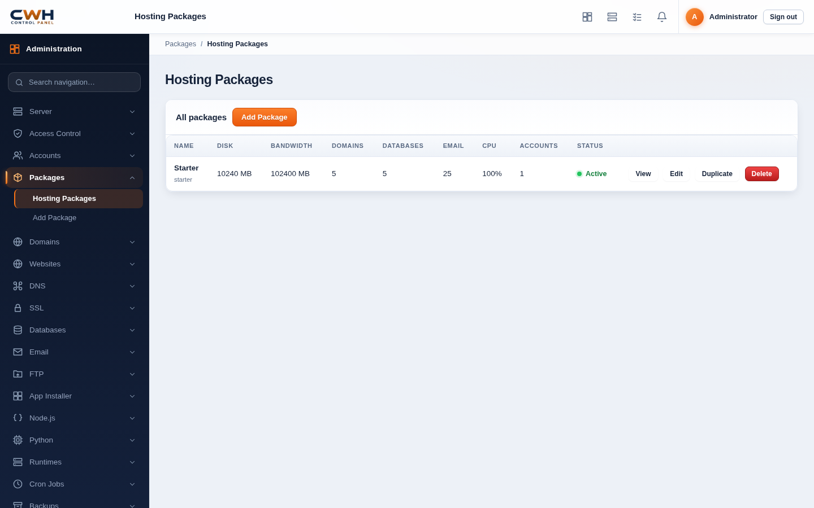

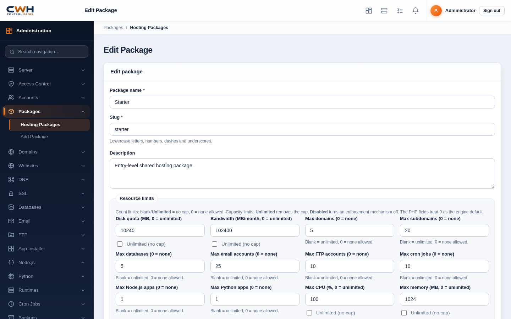

A package defines, among others:

- disk quota and **inodes**, bandwidth, max domains/subdomains, databases,
  mailboxes, FTP accounts, cron jobs, Node.js/Python apps
- CPU, RAM, IOPS and process limits (cgroups)
- **PHP version** default, PHP memory/execution/children limits
- Nginx workers, upload size, request rate (bot shield)
- which customer features are enabled (email, DNS, backups, SSL, SSH…)

### 7.3 Accounts

An **account** is a hosting customer: a Linux user, a home directory, a PHP
pool, and one or more domains.

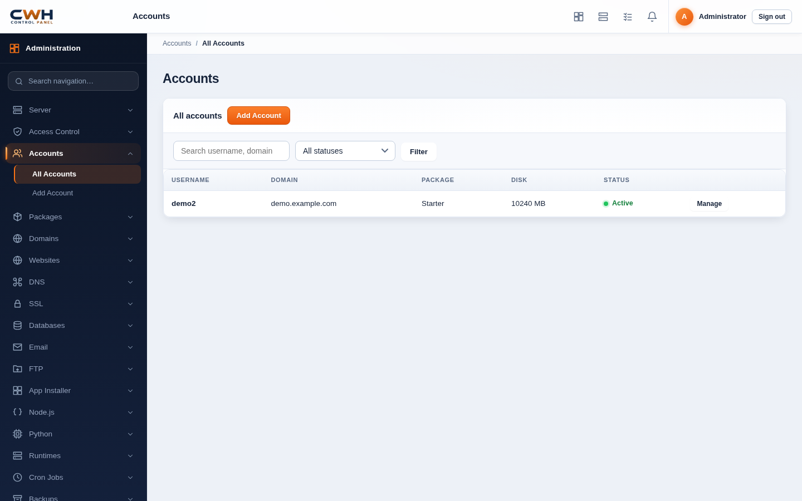

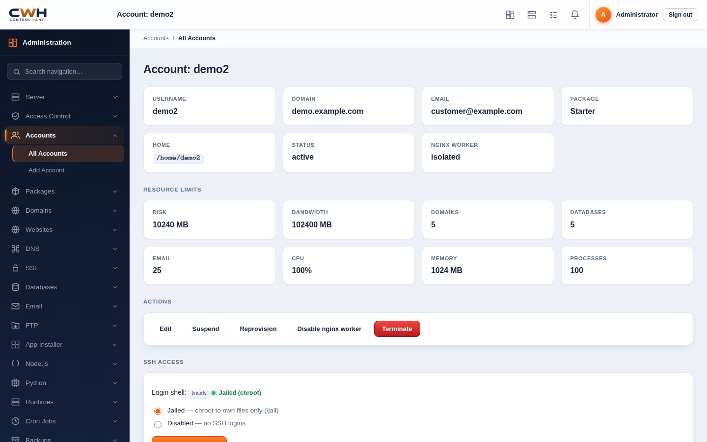

The account page shows:

- **username, primary domain, e-mail, package, home directory**
- **resource limits** (disk, bandwidth, domains, databases, mail, CPU, RAM)
- **actions** — edit, suspend, reprovision, disable the nginx worker, terminate
- **SSH access** — jailed (default), disabled, or full
- per-account **PHP settings**, **DNS**, **mail**, **FTP**, **databases** and
  **backups** are managed from their own pages.

### 7.4 Domains and Websites

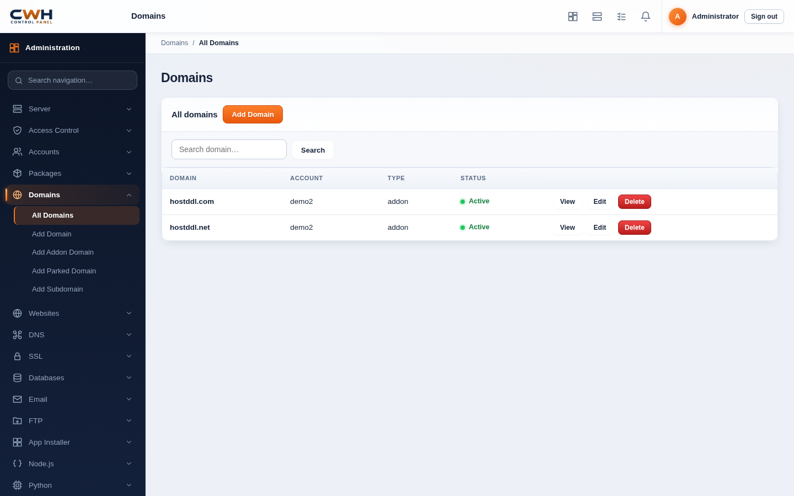

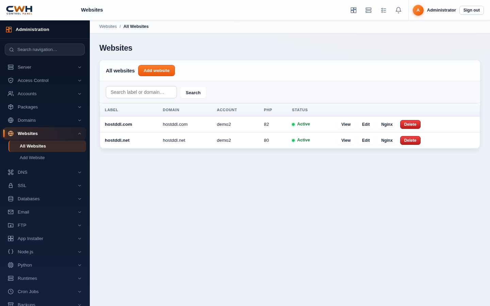

- **Domains** — the DNS/identity side: main domain, add-on, parked, subdomain.
- **Websites** — the vhost side: document root, PHP version, SSL, WAF,
  maintenance mode, custom Nginx includes, traffic stats.

A **website** belongs to a domain and an account. The document root follows
cPanel conventions:

| Type | Document root |
|---|---|
| Main | `/home/<user>/public_html` |
| Add-on | `/home/<user>/<domain>/public_html` |
| Subdomain | `/home/<user>/public_html/<sub>/` |
| Parked | alias of the primary site |

### 7.5 DNS

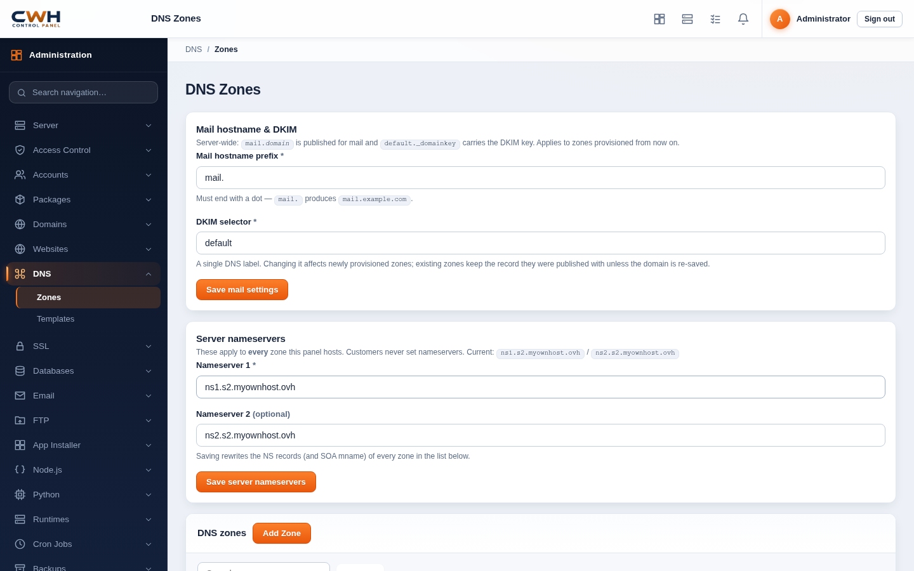

If you configured **nameservers** (Admin → DNS → Nameservers), every new domain
gets a full zone automatically: A, AAAA, `www`, NS, SOA, `mail`, MX, SPF,
DMARC, DKIM and webmail records. You can edit records, apply templates, or use
DNSSEC.

> Nameservers are **server-wide**: customers cannot change them. They belong to
> you, not to the customer's domain.

### 7.6 Email

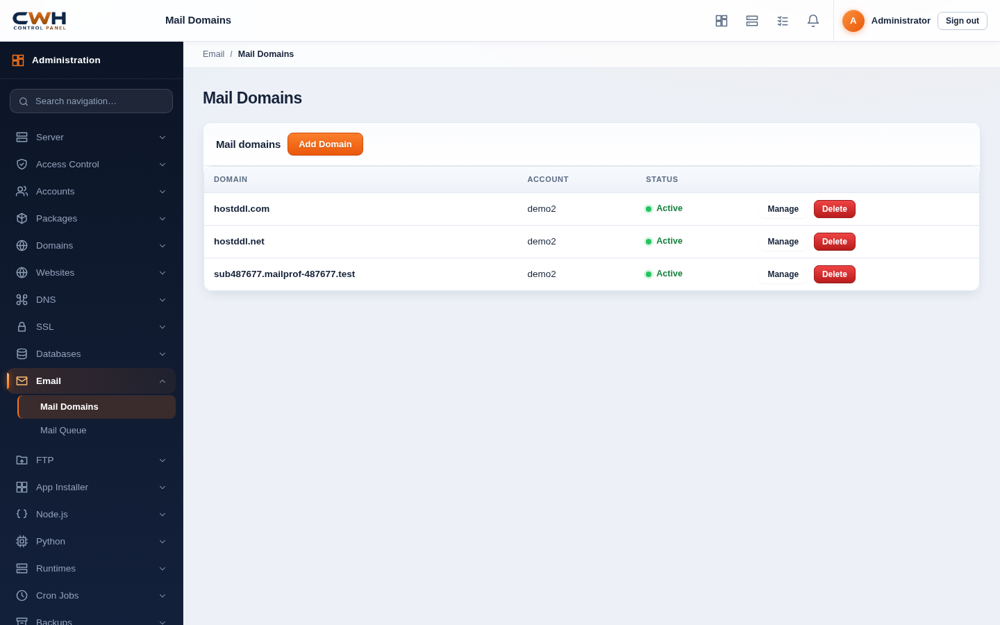

Admin → Email manages:

- **mail domains** (local vs external mail, catch-all, SPF/DMARC policy)
- **mailboxes** with quotas (enforced by Dovecot)
- **forwarders**, **mailing lists**, **autoresponders/Sieve filters**
- the **mail queue**

### 7.7 SSL

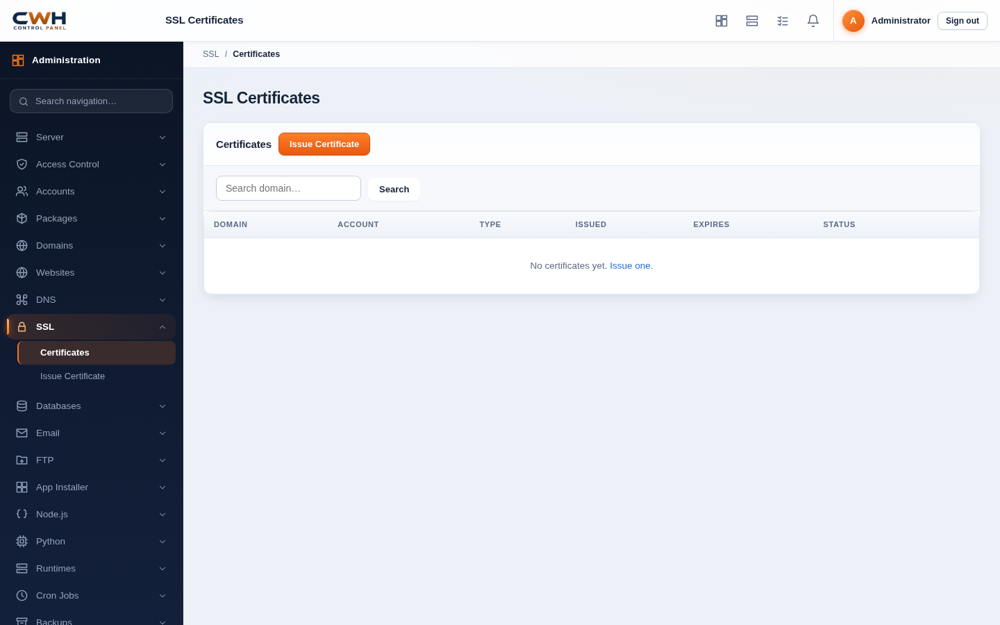

- Issue **Let's Encrypt** certificates for any domain (HTTP-01).
- Certificates are **auto-issued when a domain is added** and **auto-renewed**
  (daily check, renewal from 30 days before expiry).
- Self-signed and custom certificates are supported.
- Per-site **force HTTPS** and **HSTS** live on the website page.

### 7.8 Security

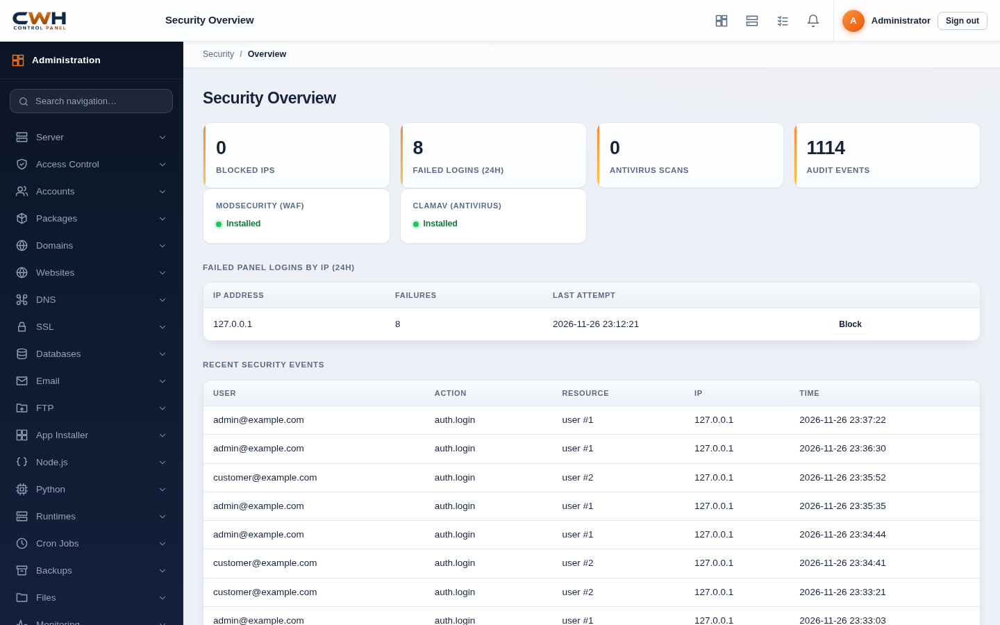

- **Firewall** — open/close ports, block/unblock IPs, allow remote MySQL
- **WAF (ModSecurity + OWASP CRS)** — per-site on/off and rule exclusions
- **Antivirus** — ClamAV status and scans
- **SSH access** — keys, jailed shell, server port
- **Audit log** — every login and admin action

### 7.9 Server

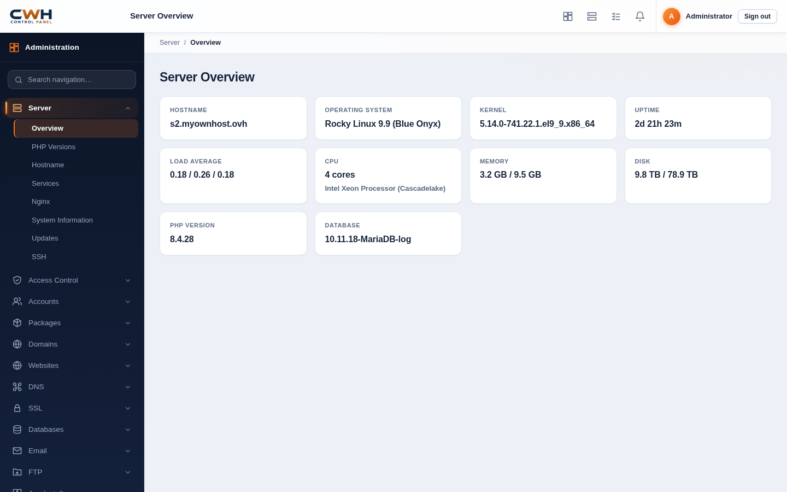

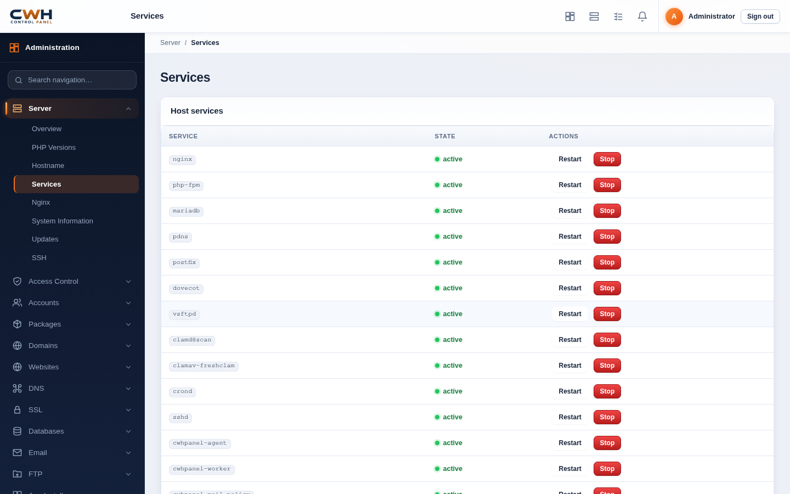

- **Services** — start/stop/restart every hosting service
- **Nginx** — config test, reload, vhost listing
- **PHP Versions** — install/uninstall PHP versions, edit `php.ini`
- **Hostname** — change the server hostname (updates DNS, mail, TLS)
- **Updates** — pending OS updates, automatic update policy, root mail forward
- **SSH** — server SSH port

### 7.10 Monitoring

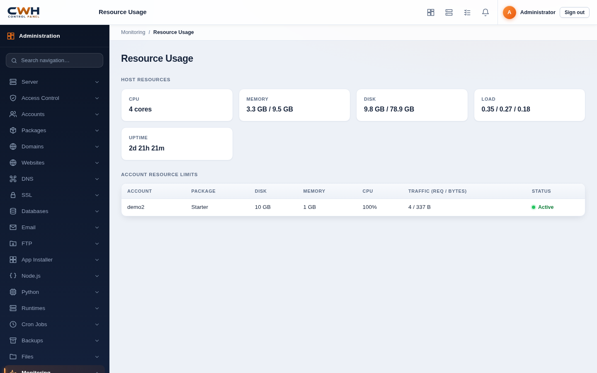

Resource overview (CPU, memory, disk, network), network throughput and
per-account bandwidth usage for the current month.

### 7.11 Backups

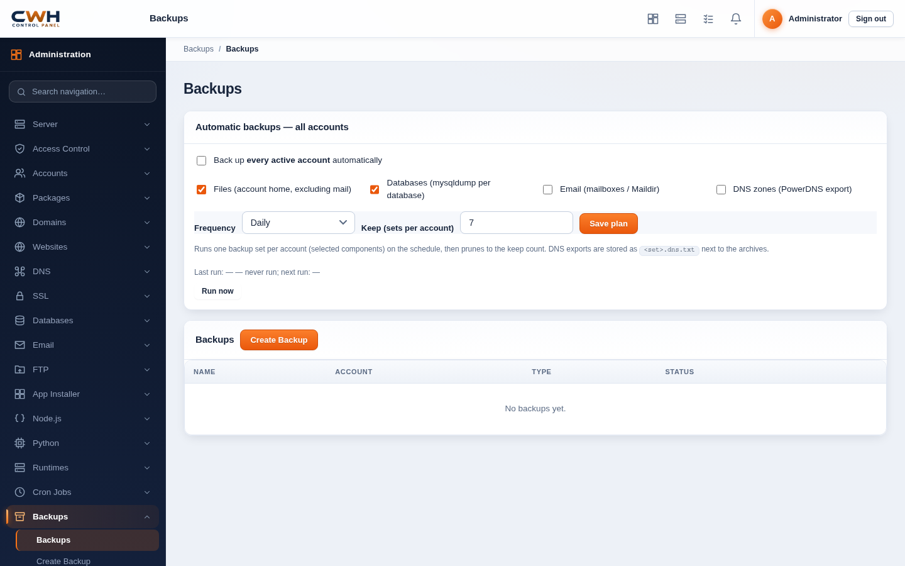

- **Per-account backups** — files, databases, mail, DNS
- **Schedules** — daily/weekly with retention
- **Remote (S3-compatible)** — encrypted off-site copies
- **Restore** — from the panel, with a safety check on SQL dumps
- a fleet backup plan — one schedule for all accounts

---

## 8. Your first hosting setup (walkthrough)

Let's create a real hosting account with a website, SSL, a mailbox and a
database.

### Step 1 — Create a package

1. **Admin → Packages → Add package**
2. Name it (e.g. `Business`), set:
   - **Disk** `10240` MB, **Bandwidth** `102400` MB
   - **Domains** `5`, **Databases** `5`, **Mailboxes** `25`
   - **PHP version** `8.4`
3. Enable the features you want customers to use (email, DNS, backups, SSL…).
4. Save.

### Step 2 — Create an account

1. **Admin → Accounts → Add account**
2. Fill in:
   - **System username** — lowercase, e.g. `acme`
   - **Primary domain** — e.g. `acme.example.com`
   - **Contact e-mail** — the customer's login e-mail
   - **Hosting package** — `Business`
   - **Password** — at least 10 characters
3. **Create account**.

The panel now creates: the Linux user + home, the PHP-FPM pool, the jailed SSH
environment, the website + vhost, the DNS zone (if nameservers are set), the
mail domain, and a certificate job.

### Step 3 — Point the domain at the server

At your registrar, create the A/AAAA records (or delegate the domain to your
nameservers). The panel already created the zone records if it hosts DNS.

### Step 4 — Check DNS and SSL

1. **Admin → DNS → Zones** — verify the records.
2. **Admin → SSL** — the certificate is either already issued or queued. If DNS
   was not ready, click **Issue** once it is.

### Step 5 — Upload the website

As the customer (or as admin via **Files**), open the **File Manager** and place
your files in `public_html`, or install an app from the **App Installer**
(WordPress, Joomla, Nextcloud…).

### Step 6 — Create a mailbox

1. **Admin → Email → Mail domains** → your domain
2. **Add mailbox** — `info@acme.example.com`, quota 1024 MB
3. The customer can open **Webmail** (Roundcube) with one click — no second
   password needed.

### Step 7 — Create a database

1. **Admin → Databases → Add database**
2. Pick a name, create a user with a strong password, grant access.
3. phpMyAdmin is available at `https://<server>/phpmyadmin/`.

### Step 8 — Hand over

Give the customer:

- the customer panel URL `https://<server>/panel/login`
- their e-mail and password
- their website/DNS names if needed

---

## 9. Customer panel tour

The customer panel is cPanel-like: a light sidebar with the tools a website
owner needs. Customers only see their own account.

### 9.1 Dashboard

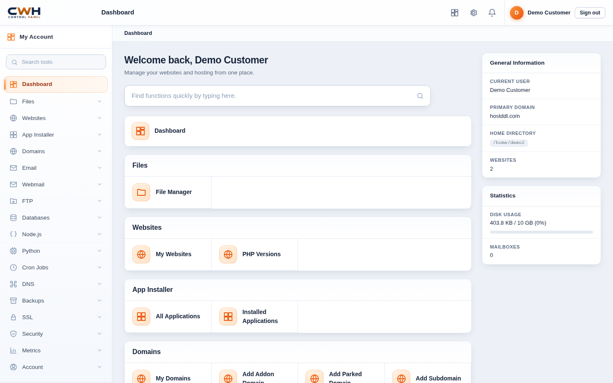

Shows the current user, primary domain, home directory, disk usage, mailbox
count, and quick links to every section.

### 9.2 Websites

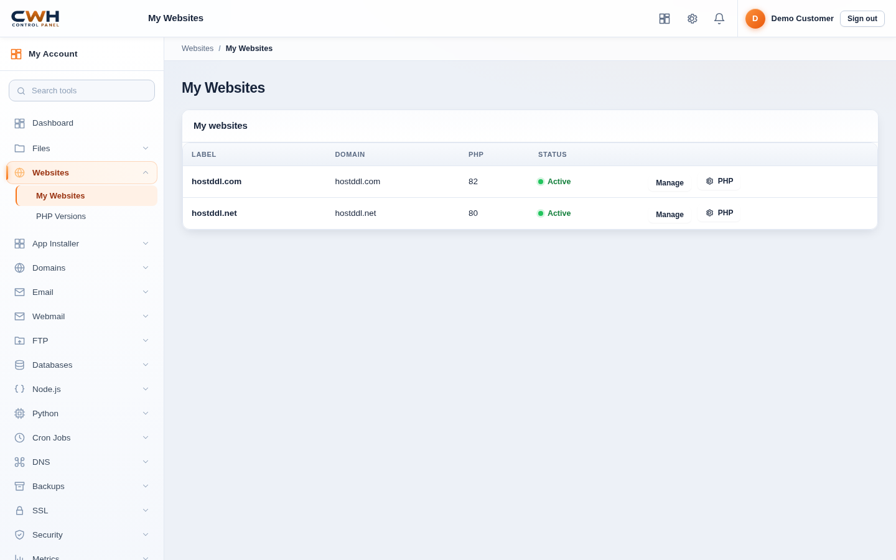

Each row is a website: document root, PHP version, SSL, maintenance mode, WAF,
traffic. Customers can switch **PHP version** and adjust PHP settings per site.

### 9.3 Domains

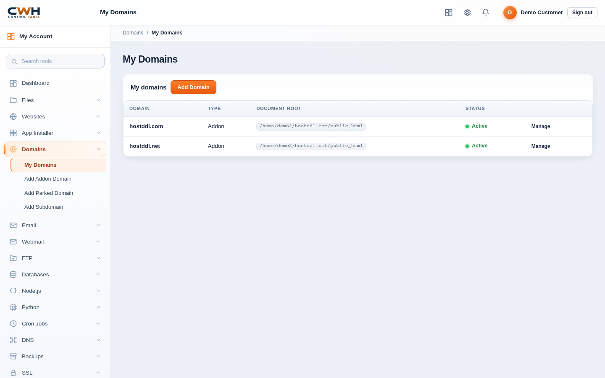

Add **add-on domains**, **parked domains** and **subdomains** (subject to the
package limits). DNS for each domain is editable here (if enabled).

### 9.4 Email

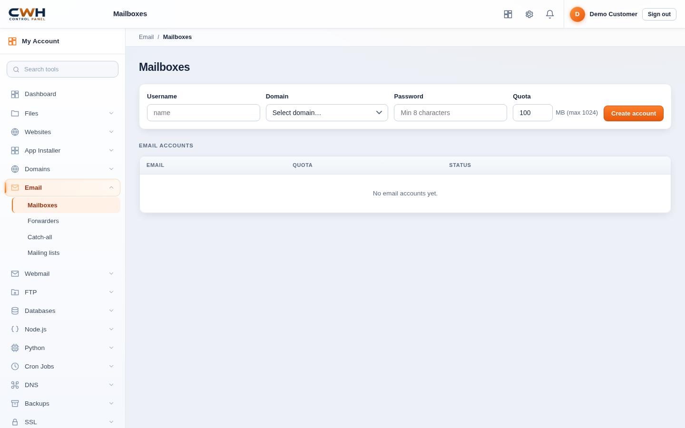

Mailboxes, forwarders, autoresponders, catch-all, mailing lists, Sieve filters
— and **Webmail** (Roundcube SSO).

### 9.5 DNS

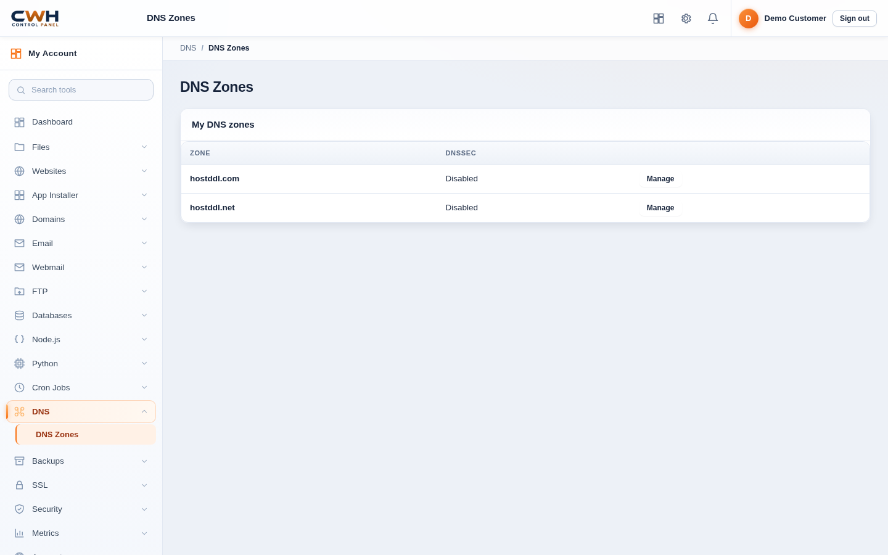

Edit records for the domains the customer owns. Nameservers are not editable by
customers (they are server-wide).

### 9.6 Files

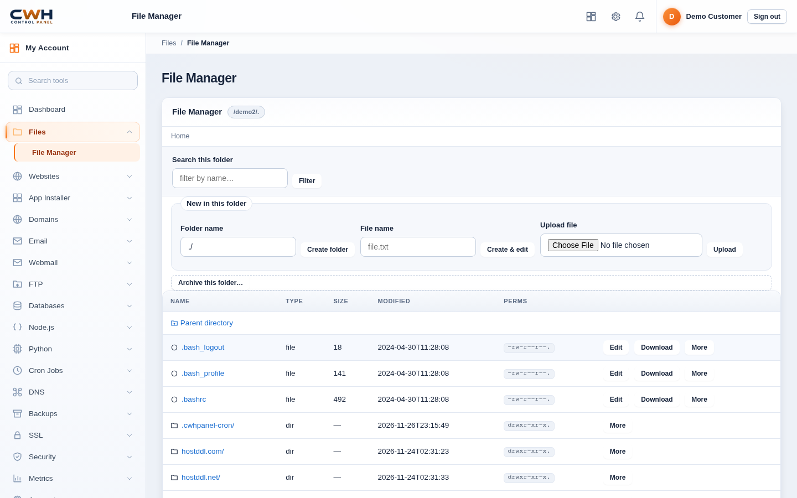

Browse, upload, edit, compress, extract, change permissions and create
directories — all confined to the account home.

### 9.7 Databases

Create databases and users, manage grants and phpMyAdmin access.

### 9.8 FTP and SSH

Create dedicated FTP logins (each with its own password and home), and manage
SSH keys. SSH is **jailed** by default (the customer sees only their own files).

### 9.9 SSL

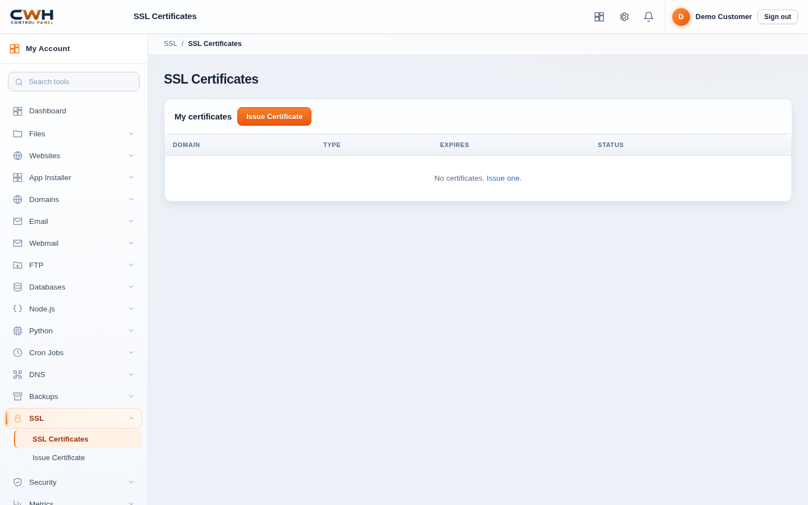

Issue and renew certificates, force HTTPS, enable HSTS.

### 9.10 Backups

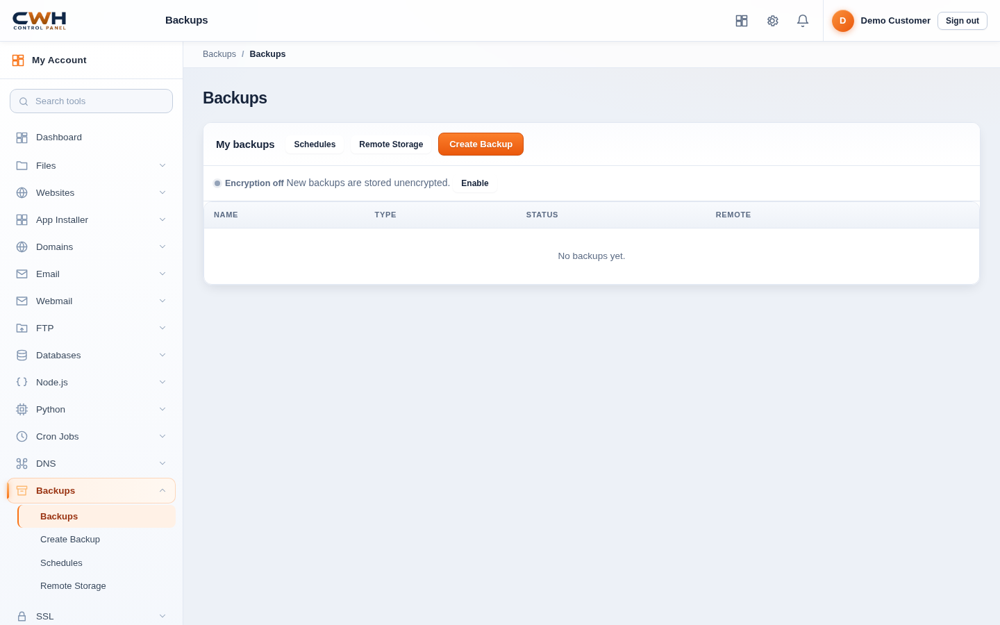

Create on-demand backups, download them, and restore from a previous one.

### 9.11 App Installer

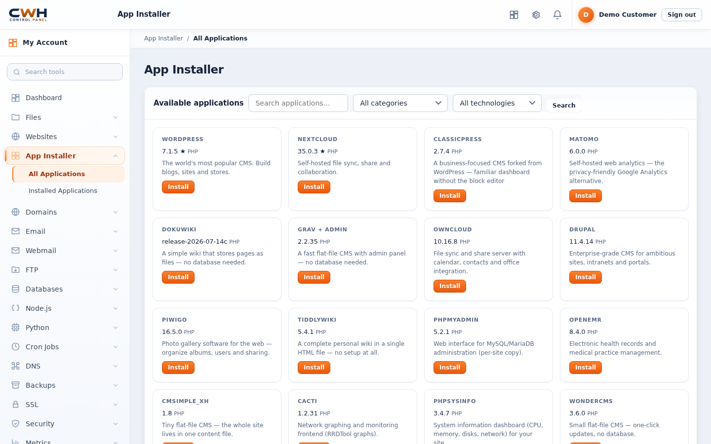

One-click installs for 90+ applications (WordPress, Joomla, Drupal,
Nextcloud, Matomo, …) into the website root or a subdirectory.

### 9.12 Cron, metrics, security

Cron jobs with output capture, bandwidth/metrics, and account security
(password, sessions, 2FA).

---

## 10. Common tasks (recipes)

### Add a website to an existing account

**Admin → Websites → Add website** (choose the account and domain), or let the
customer add a domain: **Customer → Domains → Add add-on domain**.

### Change the PHP version of one site

**Admin → Websites → (site) → PHP Settings** or **Customer → Websites → PHP
Settings**. Pick a version and save — the vhost is repointed and the pool is
provisioned automatically.

### Point a domain to another server (external DNS)

1. **Domains → (domain) → Mail & DNS** → set **Mail mode: external**.
2. At your DNS provider, create the A record + `www` + `mail` + MX + SPF +
   DKIM + DMARC records (the panel shows the exact values).

### Use Cloudflare

- Point the domain's nameservers at Cloudflare.
- In Cloudflare, create the A/AAAA records for the website and set the proxy
  status you want.
- Keep **mail** records **DNS-only** (MX, `mail`, SPF, DKIM) — Cloudflare's
  proxy does not carry SMTP.
- Let's Encrypt HTTP-01 works through Cloudflare (port 80 is proxied).

### Create a catch-all mailbox

**Email → Mail domains → (domain) → Catch-all** → set the destination address
(or leave empty to bounce).

### Add a cron job

**Customer → Cron** → schedule + command. Output is captured and visible in the
panel; jailed jobs run inside the account's jail.

### Install WordPress

**Customer → App Installer → WordPress** → choose the site/directory, admin
user/password and database → **Install**. The panel provisions the database,
downloads the app, writes `wp-config.php` and runs the installer.

### Move a site in

1. Create the account/domain.
2. Upload the files via SFTP/FTP or the File Manager.
3. Import the database via phpMyAdmin or **Databases → Import**.
4. Update the app's configuration (`wp-config.php`, `.env`, …).

---

## 11. Day-2 operations

### Check the health of the server

```bash
systemctl --failed                        # should be empty
systemctl is-active cwhpanel-agent cwhpanel-worker nginx php-fpm mariadb pdns postfix dovecot
curl -s -o /dev/null -w '%{http_code}\n' https://<server>/panel/login
```

### Logs

| What | Where |
|---|---|
| Panel application | `/opt/cwhpanel/storage/logs/panel.log` |
| Agent / worker | `journalctl -u cwhpanel-agent -u cwhpanel-worker` |
| Nginx | `journalctl -u nginx`, `/var/log/nginx/` |
| PHP-FPM | `journalctl -u php-fpm`, `/var/log/php-fpm/` |
| Mail | `journalctl -u postfix -u dovecot`, `/var/log/maillog` |
| MariaDB | `journalctl -u mariadb` |
| Firewall / bans | `fail2ban-client status` |
| Panel audit log | **Admin → Security → Audit log** |

### Updates

**Admin → Server → Updates** shows pending packages and lets you choose:

- **Off** — you patch manually
- **Security** — only security updates, installed automatically
- **All** — all updates

Manual installs run through the same engine and are serialized with a lock, so
two updates never overlap. The panel uses `dnf --nobest` so a conflicting PHP
release cannot block the whole update.

### Certificates

Certificates renew automatically (daily check, 30-day window). The renewal
cron runs Sundays at 03:17 and is visible in `/etc/cron.d/cwhpanel-renew`.
To force a renewal:

```bash
php /opt/cwhpanel/scripts/renew-certificates.php
```

### Backups

- Per account: **Admin → Backups** or **Customer → Backups**
- Schedule: choose daily/weekly and retention
- Remote: configure an S3-compatible bucket; objects are encrypted
- Always test a restore on a scratch account before you need it

### Account lifecycle

- **Suspend** — locks SSH/FTP, parks the websites (503), pauses cron, holds
  mail, stops apps. Unsuspend restores exactly what was suspended.
- **Terminate** — removes the user, pools, vhosts, DNS, mail and databases.
  Files are removed with the account (back up first).

### Quotas and limits

Disk quotas are enforced with XFS project quotas (a reboot is required the first
time they are enabled). Database size, mailbox size, bandwidth and cgroup
CPU/RAM/IO limits are enforced independently.

---

## 12. Troubleshooting

### The panel does not open

1. Check Nginx: `nginx -t` and `systemctl status nginx`.
2. Check the panel pool: `systemctl status php-fpm-panel`.
3. If `https://<server>:8443` refuses the connection, TLS was not provisioned:
   log in at `http://<server>:8443/login` or run
   `php /opt/cwhpanel/scripts/provision-hostname-tls.php`.
4. Check the application log: `tail -50 /opt/cwhpanel/storage/logs/panel.log`.

### A website returns 502 Bad Gateway

The PHP socket is missing or the pool is down:

```bash
ls /run/php-fpm/                     # look for cwh_<user>*.sock
systemctl status 'php*-php-fpm'      # the version daemon must be active
journalctl -u 'php*-php-fpm' -n 50
```

Reprovision the site's PHP pool from **Websites → PHP Settings** (save again).

### A website returns 403 Forbidden

- The document root has no `index.php`/`index.html` (Nginx does not list
  directories by default).
- Directory Privacy is enabled for that path.
- The file permissions are wrong (files 644, directories 755, owner = account).

### `nginx -t` fails after a change

Usually a custom include or a WAF rule file that no longer exists:

```bash
nginx -t
```

Fix or remove the offending file, then **Admin → Server → Nginx → Reload**.
The panel validates every vhost write and rolls back on failure, so a manual
file is the usual suspect.

### Let's Encrypt fails

- **DNS not pointing here** — check the A/AAAA record (`dig +short host`).
- **Rate limit** — 5 certificates per hostname per week. The error text includes
  the retry time.
- **Port 80 blocked** — HTTP-01 needs inbound port 80.
- **Cloudflare proxy** — HTTP-01 works, but keep `/.well-known/` reachable.

### Mail is not delivered

1. **Provider blocks port 25** — the most common cause on VPS providers.
2. Check the queue: `postqueue -p`.
3. Check SPF/DKIM/DMARC in **DNS → (zone)**.
4. Check the mail log: `journalctl -u postfix -u dovecot`.
5. A remote server may require a matching **PTR/rDNS** record — ask your
   provider to set it.

### I am locked out of the panel

After too many failed logins the panel throttles the IP/account:

```bash
php /opt/cwhpanel/scripts/unlock-login.php all
```

If you forgot the admin password:

```bash
php /opt/cwhpanel/scripts/reset-admin.php --email=admin@example.com
```

The new password is written to `.env` and printed once.

### Disk quota says unlimited but the disk is full

XFS quotas are only enforced when the filesystem was mounted with `usrquota`.
The installer patches `/etc/fstab` and the kernel command line; **one reboot**
is required on an existing server (the installer patches `/etc/fstab`).

### `dnf` updates fail on PHP packages

Rocky/Remi can propose a newer PHP stream that conflicts with installed PECL
extensions. The panel already runs `dnf upgrade --nobest`, which skips the
conflicting packages instead of failing the whole transaction.

### SELinux denials

Do **not** disable SELinux. Inspect denials instead:

```bash
ausearch -m avc -ts recent
```

The panel ships its own policy module; if you changed file locations, relabel
them (`restorecon -R <path>`) rather than turning SELinux off.

---

## 13. Uninstall

The uninstaller reverses the installation and snapshots the touched
configuration first.

```bash
cd /root/cwhpanel

./uninstall.sh --dry-run --yes    # show what would be removed, change nothing
./uninstall.sh --yes              # remove everything
```

Options:

| Flag | Effect |
|---|---|
| `--keep-packages` | keep the hosting packages (Nginx, PHP, MariaDB…) |
| `--keep-databases` | keep MariaDB databases and users |
| `--keep-accounts` | keep hosting system users and home directories |
| `--purge-backups` | also delete `/var/backups` artifacts |

A config snapshot is saved to `/root/cwhpanel-uninstall-backup/<timestamp>/`.
After the run, the script **verifies** that no panel accounts, services or cron
jobs remain and exits non-zero if anything survived.

Reboot afterwards to clear mounts and slices.

---

## 14. FAQ

**Which operating systems are supported?**
Rocky Linux 9.x x86_64. The installer relies on RPM, SELinux and systemd.

**Can I install it on Ubuntu/Debian?**
No. The agent, SELinux policy and service layout are built for RHEL 9 clones.

**Do I need a domain to install?**
No. The panel installs and is reachable over HTTP on port 8443. A domain is
required for trusted HTTPS on the panel itself.

**Can I host DNS and mail on the same server?**
Yes. Create `ns1`/`ns2` hostnames, set them in **Admin → DNS → Nameservers**,
and make sure port 25 is open at your provider for inbound mail.

**How many websites can it host?**
The limit is RAM and disk, not the panel. Rough guide: ~1 GB RAM for the stack +
~25–40 MB per active PHP-FPM worker.
For hundreds of sites, use a larger server or the pooled FPM option.

**Does it support multiple PHP versions?**
Yes — 7.4, 8.0, 8.1, 8.2, 8.3, 8.4 and 8.5 via Remi, selectable per website.

**Where are websites stored?**
Under `/home/<account>/…` with cPanel-style document roots (see
[7.4](#74-domains-and-websites)).

**Can I use Cloudflare?**
Yes. Keep mail records DNS-only; HTTP/HTTPS can be proxied.

**Is there a WHMCS/billing integration?**
Not built in. There is an administrator-only API; billing integrations would be
custom.

**How do I back up the panel itself?**
Back up `/opt/cwhpanel/.env`, `/etc/cwhpanel`, and the MariaDB `cwhpanel`
database. The uninstaller snapshots configs automatically.

**What does it cost?**
This edition is free of charge for commercial use (hosting your own and your
customers' sites) under the license terms. See [16](#16-license-and-support).

---

## 15. Security checklist

After installation:

- [ ] Change the admin password and **enable 2FA**
- [ ] Keep SELinux **enforcing**
- [ ] Keep the firewall on; expose only the ports you need
- [ ] Keep `fail2ban` running (it watches SSH, mail, FTP and web scanners)
- [ ] Enable automatic **security updates** (Admin → Server → Updates)
- [ ] Configure **backups** and test a restore
- [ ] Use strong, unique passwords for MySQL/FTP/mail
- [ ] Restrict admin access by IP at the firewall if possible
- [ ] Review the **audit log** and **security overview** weekly
- [ ] Monitor the certificate expiry (renewal is automatic, but watch it)
- [ ] Keep the panel updated (pull the latest tree and re-run the installer)

The panel already applies a hardened baseline: SELinux policy, per-account
isolation, jailed SSH, forced FTPS, TLS 1.2+ with PFS-only ciphers, DKIM/SPF/
DMARC by default, ModSecurity + OWASP CRS, and least-privilege database access.

---

## 16. License and support

CWH Control Panel is **proprietary software** (not open source). It is licensed,
not sold, under the terms in [`LICENSE`](LICENSE). This edition is licensed
free of charge for commercial hosting use under the same restrictions.

- Licensor: **Nasserddine F.**, auto-entrepreneur (Morocco, ICE 001753903000019)
- Website: <https://cheap-web-hosting.org>
- Licensing / commercial: <sales@cheap-web-hosting.org>
- Governing law: Morocco

You may not redistribute, sublicense, resell, or offer the panel itself as a
hosted/managed control-panel service without a separate written agreement.
Bundled third-party components are listed in
[`THIRD_PARTY_LICENSES.md`](THIRD_PARTY_LICENSES.md).

---

*Screenshots in this guide come from a live demo installation; account names,
domains and addresses are examples.*
